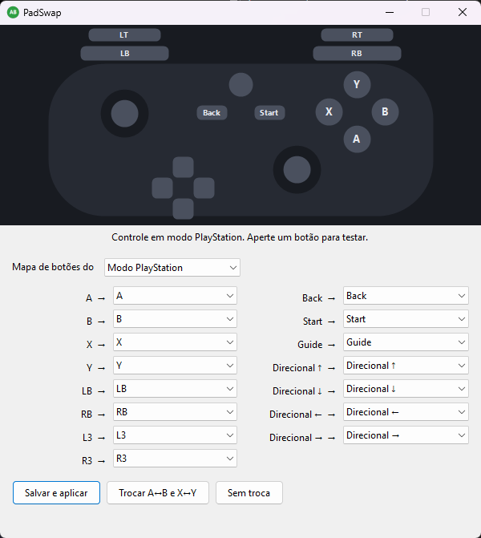

# PadSwap

A small Windows tray app that fixes controllers with a Nintendo-style button layout (A/B and X/Y swapped) for **every** game, with no per-game setup.

Most remappers create a remapped virtual controller but leave the physical one visible, so games read both at once and the swap appears not to work. PadSwap hides the physical controller and gives games a single, correctly mapped virtual Xbox 360 controller.

## How it works

```
physical controller ──read──> PadSwap ──remapped state──> virtual Xbox 360 pad ──> games
        │                                                   (ViGEmBus)
        └── hidden from every other process (HidHide)
```

- **Input:** the physical controller is read directly, either through the Xbox 360 driver (XUSB, the interface XInput itself uses) or as a wired DualShock 4 over raw HID. Multi-mode controllers that switch between the two are handled automatically.
- **Output:** a virtual Xbox 360 controller created through [ViGEmBus](https://github.com/nefarius/ViGEmBus).
- **Hiding:** [HidHide](https://github.com/nefarius/HidHide) blocks every other process from opening the physical controller. PadSwap registers itself and hides the controller on its own.
- Rumble sent by games to the virtual controller is forwarded to the physical one.

## Requirements

- Windows 10/11 x64
- [.NET 10 Desktop Runtime](https://dotnet.microsoft.com/download/dotnet/10.0) (or newer)
- [ViGEmBus](https://github.com/nefarius/ViGEmBus/releases)
- [HidHide](https://github.com/nefarius/HidHide/releases) (`winget install Nefarius.HidHide`). After installing it, reboot or replug the controller once.

## Build and install

```powershell
dotnet publish -c Release -o "$env:LOCALAPPDATA\Programs\PadSwap"
```

Run `PadSwap.exe` from that folder. Keep it in a fixed location: HidHide allows applications by path.

The tray icon is green when the remap is active, grey while waiting for a controller and red on error. The tray menu (in Portuguese) has "settings", "start with Windows", "open log" and "exit". Exiting makes the physical controller visible again.

Double-click the tray icon (or start with `--settings`) to open the settings window. It shows live what the game is receiving and lets you edit the button map; saving applies it immediately.



Start PadSwap before the game. A game that already opened the physical controller keeps seeing it until it is restarted.

## Button map

The settings window writes `padswap.json` next to the executable, with one section per controller mode. You can also edit it by hand. Buttons not listed pass through unchanged, and without the file the defaults below apply.

```json
{
  "xbox": { "A": "B", "B": "A", "X": "Y", "Y": "X" },
  "playstation": {}
}
```

Each entry is `"physical button": "button the game receives"`. Names: `A`, `B`, `X`, `Y`, `LeftShoulder`, `RightShoulder`, `LeftThumb`, `RightThumb`, `Start`, `Back`, `Guide`, `DpadUp`, `DpadDown`, `DpadLeft`, `DpadRight`. In PlayStation mode the buttons are first translated by position (Cross = A, Circle = B, Square = X, Triangle = Y). Restart PadSwap after editing the file by hand.

## Diagnostics

Output is only visible when redirected, since this is a windowed app:

```powershell
.\PadSwap.exe --probe 5 | Out-String    # list controllers and print state changes for 5 s
.\PadSwap.exe --learn 60 | Out-String   # print the face buttons in the order you press them
.\PadSwap.exe --xinput | Out-String     # what the XInput API reports to this process
```

The log is at `%LOCALAPPDATA%\PadSwap\padswap.log`.

## Limitations

- One controller at a time (the first physical one found).
- PlayStation mode supports wired DualShock 4 compatible pads only (`054C:05C4`, `054C:09CC`); the touchpad click is not mapped.
- Only buttons are remapped. Sticks and triggers pass through as they are.
- Xbox mode with HidHide active has seen little testing.

## License

[MIT](LICENSE). ViGEmBus and HidHide are separate projects by Nefarius Software Solutions with their own licenses.
